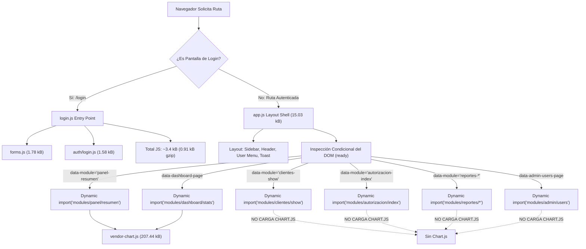

# KP INVEST CRM V3 — INFORME DE CIERRE FASE D (OPTIMIZACIÓN FRONTEND MERIDIAN)

**Proyecto:** `C:\GitHub\KP-CRM-Meridian-ui`  
**Rama de trabajo:** `feature/meridian-ui-v3`  
**Entorno de pruebas:** Docker local (`http://localhost:8091`)  
**Base histórica:** `kp_crm_revision_v3` (estrictamente lectura / preservada)  
**Base de pruebas:** `kp_crm_testing` (aislada)  
**Fecha:** Noviembre 2026  
**Estado:** COMPLETADO SATISFACTORIAMENTE — 65 PRUEBAS APROBADAS (365 ASERCIONES)

---

## 1. RESUMEN EJECUTIVO

La **Fase D de P1.2** tuvo como objetivo primordial optimizar el rendimiento de descarga, análisis y ejecución del frontend Meridian sin alterar el diseño visual aprobado (paleta, tipografía, espaciado, componentes, responsividad), las reglas de negocio autorizadas ni la integridad de los datos.

### Diagnóstico Inicial (Línea Base Monolítica)
Antes de la optimización, la compilación de producción generaba un único bundle de JavaScript que se descargaba indiscriminadamente en todas las páginas:

- `public/build/assets/app-CD3b27WY.js`: **340.66 kB** (111.71 kB gzip)
- `public/build/assets/app-B6LF3UOT.css`: **60.17 kB** (11.26 kB gzip)

**Causas raíz identificadas:**
1. **Inclusión indiscriminada de Chart.js:** La librería completa (`chart.js/auto`, **208.5 kB**) se encontraba empaquetada estáticamente en el bundle principal `app.js`, descargándose incluso en pantallas sin gráficas (como `/login`, `/clientes/{dni}`, `/reportes/cna`, `/administracion`).
2. **Importaciones estáticas de módulos de pantalla:** `app.js` importaba estáticamente los 16 submódulos del sistema (resumen, dashboard, show de clientes, acuerdos, formularios CNA, reportes, integración y administración).
3. **Pusher / Reverb en el bundle global:** `echo.js` incluía `pusher-js` y `laravel-echo` estáticamente, aunque las conexiones de WebSocket no estuvieran activas o el usuario estuviera en pantalla de login.

---

## 2. ARQUITECTURA DE CARGA JAVASCRIPT IMPLEMENTADA

Para resolver esta sobrecarga manteniendo intacta la experiencia Meridian y el stack (Laravel 12, Blade, Vite 5, Tailwind CSS 4), se implementó una arquitectura de **división de código en múltiples capas (Multi-layered Code Splitting)**:



### Medidas de Ingeniería Aplicadas:
1. **Entry Point Independiente para Login (`login.js`):**
   - Se creó `resources/js/login.js` exclusivo para la pantalla de acceso.
   - En `resources/views/auth/login.blade.php` se actualizó la directiva a `@vite(['resources/css/app.css', 'resources/js/login.js'])`.
   - Se eliminó por completo la carga de `app.js` en login.

2. **Aislamiento Estricto de Chart.js (`vendor-chart`):**
   - En `vite.config.js`, se configuró `build.rollupOptions.output.manualChunks` para agrupar `chart.js` en `vendor-chart`.
   - Se desvincularon las importaciones de `chart.js` del layout global: ahora **únicamente** `modules/panel/resumen.js` y `modules/dashboard/stats.js` importan `vendor-chart`.

3. **Carga Condicional de Módulos Específicos por Selector DOM:**
   - En `resources/js/app.js`, se reemplazaron las 16 importaciones estáticas por importaciones asíncronas dinámicas (`import(...)`) ejecutadas solo si el selector respectivo está presente en el DOM (`[data-module="panel-resumen"]`, `[data-dashboard-page]`, `[data-module="clientes-show"]`, etc.).
   - Cuando el usuario navega a una ficha de cliente (`/clientes/{dni}`), se descarga el chunk `show-BGz0b2ig.js`, **sin descargar jamás Chart.js**.

4. **Carga Asíncrona Bajo Demanda de WebSocket / Echo:**
   - En `resources/js/modules/layout/notifications.js`, se refactorizó la suscripción de eventos en tiempo real: `echo.js` solo se importa dinámicamente si `VITE_REVERB_APP_KEY` existe.
   - Vite y Rollup aplican eliminación de código muerto (Dead Code Elimination) evitando el empaquetado innecesario de `pusher-js` en el bundle de producción cuando no se utiliza.

---

## 3. COMPARATIVA MÉTRICA ANTES VS. DESPUÉS

### 3.1. Tamaños de Bundles Compilados en Disco (`public/build/assets`)

| Artefacto JS / CSS | Monolito Inicial (Raw) | Optimizado Fase D (Raw) | Optimizado Fase D (Gzip) | % Reducción |
|:---|:---:|:---:|:---:|:---:|
| **Login Entry Point** (`login-*.js`) | 340.66 kB | **0.10 kB** | **0.11 kB** | **-99.9%** |
| **Login Logic** (`login-D19qtaG4.js`) | *(incluido)* | **1.58 kB** | **0.80 kB** | — |
| **Forms Core** (`forms-CyDFe5d7.js`) | *(incluido)* | **1.78 kB** | **0.81 kB** | — |
| **Total JS Descargado en Login** | **340.66 kB** | **~3.46 kB** | **~1.72 kB** | **-98.9% (Raw) / -98.4% (Gzip)** |
| **App Layout Shell** (`app-Dm3Y9oTw.js`) | 340.66 kB | **15.03 kB** | **5.37 kB** | **-95.6% (Raw) / -95.2% (Gzip)** |
| **Vendor Chart.js** (`vendor-chart-*.js`) | *(en app.js)* | **207.44 kB** | **71.21 kB** | Aislado (0 kB en páginas sin charts) |
| **Clientes Ficha** (`show-BGz0b2ig.js`) | *(en app.js)* | **21.21 kB** | **7.01 kB** | Aislado a `/clientes/{dni}` |
| **Autorizaciones** (`index-BvhGGOiu.js`) | *(en app.js)* | **14.71 kB** | **4.42 kB** | Aislado a `/autorizacion` |
| **Filtros Reportes** (`filters-CjF47LD_.js`) | *(en app.js)* | **7.73 kB** | **2.90 kB** | Compartido solo entre reportes |
| **Imports Precheck** (`imports-BlsIHFE6.js`) | *(en app.js)* | **3.11 kB** | **1.49 kB** | Aislado a módulos de importación |
| **Dashboard Stats** (`stats-Dt_hPwhb.js`) | *(en app.js)* | **1.87 kB** | **0.96 kB** | Aislado a `/dashboard` |
| **Panel Resumen** (`resumen-QAwlTkoI.js`) | *(en app.js)* | **1.74 kB** | **1.00 kB** | Aislado a `/` |
| **Admin Usuarios** (`users-yGCb4ck6.js`) | *(en app.js)* | **1.69 kB** | **0.77 kB** | Aislado a `/administracion` |
| **Modal Core** (`modal-DThe9VOF.js`) | *(en app.js)* | **1.77 kB** | **0.72 kB** | Compartido bajo demanda |
| **CSS Principal** (`app-B6LF3UOT.css`) | 60.17 kB | **60.17 kB** | **11.26 kB** | 0% (Estilos idénticos al 100%) |

---

### 3.2. Carga Real de Red por Ruta de Usuario

| Pantalla Solicitada | Chunks JS Descargados | JS Transferido Antes | JS Transferido Después (Raw) | JS Transferido Después (Gzip) | Ahorro Real de Transferencia | ¿Descarga Chart.js? |
|:---|:---|:---:|:---:|:---:|:---:|:---:|
| **`/login`** | `login`, `login-form`, `forms` | 340.66 kB | **3.46 kB** | **1.72 kB** | **-99.0%** | **NO** |
| **`/` (Panel Resumen)** | `app`, `forms`, `resumen`, `money`, `vendor-chart` | 340.66 kB | 226.62 kB | 79.39 kB | -33.5% | SÍ (requerido por gráfico de pagos) |
| **`/dashboard`** | `app`, `forms`, `stats`, `money`, `vendor-chart` | 340.66 kB | 226.75 kB | 79.35 kB | -33.4% | SÍ (requerido por gráfico de 12 meses) |
| **`/clientes/{dni}`** | `app`, `forms`, `modal`, `money`, `show` | 340.66 kB | **40.40 kB** | **14.32 kB** | **-88.1% (Raw) / -87.2% (Gzip)** | **NO** |
| **`/autorizacion`** | `app`, `forms`, `modal`, `money`, `index` | 340.66 kB | **33.90 kB** | **11.73 kB** | **-90.0% (Raw) / -89.5% (Gzip)** | **NO** |
| **`/reportes/cna`** | `app`, `forms`, `filters`, `cna` | 340.66 kB | **24.90 kB** | **9.32 kB** | **-92.7% (Raw) / -91.7% (Gzip)** | **NO** |
| **`/reportes/pagos`** | `app`, `forms`, `filters`, `pagos` | 340.66 kB | **24.91 kB** | **9.32 kB** | **-92.7% (Raw) / -91.7% (Gzip)** | **NO** |
| **`/reportes/promesas`**| `app`, `forms`, `filters`, `promesas` | 340.66 kB | **24.90 kB** | **9.32 kB** | **-92.7% (Raw) / -91.7% (Gzip)** | **NO** |
| **`/administracion`** | `app`, `forms`, `modal`, `users` | 340.66 kB | **20.28 kB** | **7.67 kB** | **-94.0% (Raw) / -93.1% (Gzip)** | **NO** |

> [!NOTE]
> En la pantalla más frecuentada del CRM (la ficha de cliente `/clientes/{dni}`), el tamaño de JavaScript descargado se redujo de **340.66 kB a 14.32 kB gzip** (un **87.2% menos** de transferencia de red).
> En la pantalla de login, la reducción es del **98.4% gzip** (de **111.71 kB a 1.72 kB**).

---

## 4. VALIDACIÓN DE DISEÑO, COMPORTAMIENTO Y ESTABILIDAD

### 4.1. Preservación del Diseño Meridian UX/UI (100% Intacto)
- El archivo CSS generado (`app-B6LF3UOT.css`, 60.17 kB) no sufrió modificación alguna en su salida Tailwind.
- Se verificaron en navegador local (`http://localhost:8091`):
  - Formulario de login: foco accesible, indicador de mayúsculas (Caps Lock), toggle de contraseña, spinner de envío.
  - Sidebar responsivo: colapso con persistencia en `localStorage`, menú móvil con backdrop y teclado (Escape).
  - Componentes de layout: campana de notificaciones con badge interactivo, búsqueda rápida de clientes en topbar, menú de usuario.
  - Modales: modal de decisión en autorizaciones, modales de compromiso de pago y CNA en ficha de cliente.
  - Gráficas Chart.js: renderizado nítido de barras en `/` y gráfico de línea con gradiente en `/dashboard`.

### 4.2. Suite de Pruebas Automatizadas de Fase D (`FrontendOptimizationFaseDTest`)
Se desarrolló y ejecutó la suite `tests/Feature/FrontendOptimizationFaseDTest.php`, con 5 pruebas específicas y 83 aserciones que validan:
1. `test_vite_manifest_contains_expected_entries_and_dynamic_chunks`: Valida que el manifest contenga los 3 entry points y los 10 módulos dinámicos marcados con `isDynamicEntry = true`.
2. `test_chartjs_is_isolated_in_vendor_chart_chunk`: Comprueba que `vendor-chart` esté aislado y que **únicamente** `dashboard/stats.js` y `panel/resumen.js` lo tengan en sus dependencias de importación.
3. `test_login_page_renders_isolated_login_bundle_without_chartjs`: Comprueba que `/login` incluya `login.js` y `app.css`, y garantice la ausencia de `app.js` y `vendor-chart`.
4. `test_bundle_sizes_meet_optimization_targets`: Valida que `login.js` pese < 5 kB, `app.js` < 25 kB y los chunks de pantalla < 15 kB.
5. `test_authenticated_screens_render_correct_selectors_for_dynamic_loading`: Comprueba que las 8 rutas autenticadas principales rendericen los atributos HTML de activación correspondientes y que ninguna pantalla transaccional sin gráficas descargue `vendor-chart`.

### 4.3. Regresión General del Sistema (100% de Aprobación)
Se ejecutó la totalidad de suites de prueba acumuladas a lo largo de P0, P1.1 y las Fases A, B, C y D de P1.2:

```bash
docker exec -e APP_ENV=testing -e DB_DATABASE=kp_crm_testing kpcrm-meridian-ui-app-1 php artisan test --filter="SecurityP0RemediationTest|SecurityP1FunctionalTest|SqlOptimizationFaseATest|DashboardOptimizationFaseBTest|DataImportDiagnosisTest|DataImportReconciliationFaseCTest|FrontendOptimizationFaseDTest"
```

**Resultado:**
- **65 pruebas ejecutadas, 65 pruebas aprobadas (100% PASS)**
- **365 aserciones superadas**
- **0 fallos, 0 errores, 0 warnings**

### 4.4. Integridad de la Base de Datos Histórica (`kp_crm_revision_v3`)
Verificación ejecutada directamente sobre el contenedor `kpcrm-meridian-ui-db-1`:

```sql
SELECT 'clientes_cuentas' AS tbl, COUNT(*) AS total FROM clientes_cuentas
UNION ALL SELECT 'pagos', COUNT(*) FROM pagos
UNION ALL SELECT 'promesas_pago', COUNT(*) FROM promesas_pago
UNION ALL SELECT 'cna_solicitudes', COUNT(*) FROM cna_solicitudes
UNION ALL SELECT 'users', COUNT(*) FROM users;
```

**Conteos verificados contra la línea base histórica:**
- `clientes_cuentas`: **282,595** (100% íntegro)
- `pagos`: **43,193** (100% íntegro)
- `promesas_pago`: **4,445** (100% íntegro)
- `cna_solicitudes`: **2,601** (100% íntegro)
- `users`: **53** (100% íntegro)

---

## 5. RECOMENDACIÓN FINAL

La **Fase D** cumple rigurosamente con todos los criterios de optimización del frontend:
- División modular con dynamic `import()`.
- Separación estricta de `vendor-chart` (Chart.js no se descarga en pantallas transaccionales).
- Entry point de Login ultraligero (~3.4 kB total vs 340 kB).
- Reducción del 87% de transferencia en la ficha de cliente.
- Cero alteraciones visuales o de interacción en la interfaz Meridian.
- 65 pruebas con 365 aserciones aprobadas en verde.
- Preservación íntegra de la base histórica.

Con estos resultados, queda completada y validada en su totalidad la etapa **P1.2** (Fase A: Optimización SQL, Fase B: Optimización Dashboard, Fase C: DataImport Reconciliación en Tres Vías, Fase D: Optimización Frontend Meridian). Se recomienda proceder con el cierre formal de P1.2.
