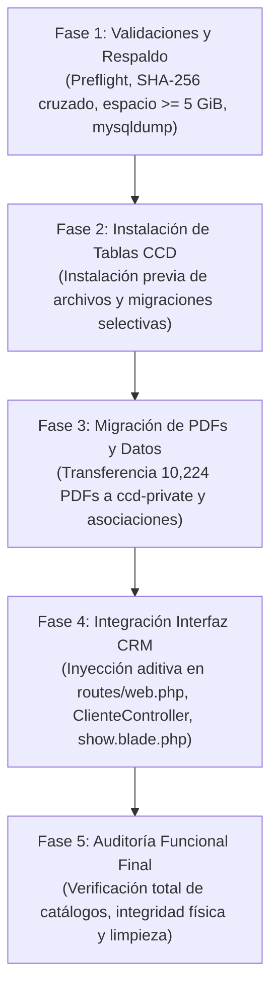

# KP INVEST — Informe de Migración a Producción CCD V6.2.1 (Corrección de Errores de Ejecución y Adaptación LEGACY)

## 1. Resumen Ejecutivo y Objetivos

El presente documento describe la arquitectura técnica, controles de integridad, compatibilidad de hosting, protección de credenciales, plan de contingencia y el procedimiento de ejecución del desplegador y migrador **V6.2.1** para el traslado de las **10,224 asociaciones CCD AQP4/AQP5** y sus archivos PDF privados correspondientes desde el entorno de staging (`u480021566_prueba`) al entorno de producción real (`u480021566_kpinvest_bd`) de **KP INVEST**, adaptado específicamente a la **arquitectura LEGACY** instalada en Hostinger y con las correcciones operativas identificadas en la revisión de despliegue.

### Datos de Entornos

| Parámetro | Staging (Origen) | Producción (Destino LEGACY) |
| :--- | :--- | :--- |
| **Host / Servidor** | Hostinger Cloud SSH | Hostinger Cloud SSH |
| **Ruta de Aplicación** | `/home/u480021566/apps/kpinvest-crm-pruebas` | `/home/u480021566/domains/impulse-go.com/public_html/plataforma-crm` |
| **Base de Datos** | `u480021566_prueba` | `u480021566_kpinvest_bd` |
| **Conexión MySQL** | `u480021566_kpprueba@localhost` | `u480021566_kpinvest@127.0.0.1` |
| **Repositorio Git** | `ilustroc/kpinvest-crm-app` | `ilustroc/kpinvest-crm-app` |
| **Rama de Entrega** | `codex/ccd-aqp-v6-2-produccion-legacy` | `codex/ccd-aqp-v6-2-produccion-legacy` |

---

## 2. Diagnóstico de la Arquitectura Real de Producción LEGACY

A diferencia de la rama de desarrollo que introdujo subcarpetas de rutas (`routes/web/clientes.php`) y servicios desacoplados (`ClienteProfileService.php`), la aplicación en producción real opera con una estructura monolítica probada:

1. **Rutas Monolíticas Centralizadas:**
   - Todas las rutas del sistema residen en `routes/web.php`.
   - No existe el archivo `routes/web/clientes.php`.
   - Las rutas de clientes están bajo `Route::prefix('clientes')->group(...)` dentro del middleware `auth`.
2. **Controlador Directo de Clientes:**
   - La lógica de negocio y visualización reside en `app/Http/Controllers/ClienteController.php`.
   - No existe la clase `app/Services/Cliente/ClienteProfileService.php`.
   - El método `ClienteController::show(string $dni)` gestiona directamente `$cuentas`, `$pagos`, `$promesas`, `$cnas`, `$ccdDocs`, `$ccdByDni` y `$ccdByCodigo`.
3. **Vista de Cliente con Celdas Específicas:**
   - La vista utilizada es `resources/views/clientes/show.blade.php`.
   - Renderiza una tabla con la sección delimitada `{{-- === CELDA CCD === --}}`.
4. **Restricciones de Funciones PHP en Hostinger:**
   - Hostinger deshabilita funciones como `exec()`, `shell_exec()` y `system()` por motivos de seguridad compartida.
   - La función `proc_open()` está completamente disponible.

---

## 3. Correcciones Implementadas en V6.2

### 3.1. Verificación de Sintaxis PHP Compatible con Hostinger (Sin `exec()`)
Se rediseñó `CcdProductionMigratorService::assertPhpSyntax(string $filePath)`:
- Utiliza `proc_open([$phpBinary, '-l', $filePath], ...)` para invocar el linter nativo de PHP mediante descriptores de tuberías de entrada/salida.
- Captura `stdout` y `stderr` sin requerir `exec()`.
- Incorpora un mecanismo de contingencia nativo mediante `token_get_all($code, TOKEN_PARSE)` que detecta cualquier `ParseError` directamente en memoria si el entorno impidiera subprocesos.

### 3.2. Carga Segura de Credenciales desde la Configuración Efectiva de Laravel
Se erradicó la lectura manual e insegura mediante `grep` y `cut` en archivos `.env`:
- El script desplegador arranca el bootstrap de Laravel (`bootstrap/app.php`) en subprocesos aislados para staging y producción.
- Obtiene la configuración efectiva autenticada:
  - Staging: `u480021566_kpprueba@localhost`.
  - Producción: `u480021566_kpinvest@127.0.0.1`.
- Admite caracteres especiales, contraseñas complejas y variables multilínea que rompían el parser Bash anterior.
- Genera un archivo JSON temporal con permisos restrictivos `0600` (`~/.ccd_credentials/`), el cual es eliminado de manera garantizada mediante la trampa `trap cleanup_credentials EXIT INT TERM`.
- Ninguna contraseña se imprime en terminal, ni se pasa como parámetro visible en `ps aux`, ni se registra en logs o manifiestos.

### 3.3. Vinculación Estricta por Operación (`cliente_cuenta_id = clientes_cuentas.id`)
Para evitar asociar indiscriminadamente todos los CCDs de un mismo DNI a todas las operaciones del cliente:
1. **Inclusión de Clave Primaria:** Se asegura la columna `id` en la consulta `ClienteCuenta::query()->get(['id', 'numdoc', ...])`.
2. **Asociación Específica:**
   ```php
   $confirmedLinks = CcdClienteCuenta::query()
       ->whereIn('ccd_cliente_id', $ccdDocs->pluck('id'))
       ->where('estado', CcdClienteCuenta::ESTADO_CONFIRMADA)
       ->with('ccdCliente:id,numdoc,pdf,cosecha,link')
       ->get()
       ->filter(fn ($link) => $link->ccdCliente !== null && hash_equals((string) $dni, (string) $link->ccdCliente->numdoc))
       ->groupBy('cliente_cuenta_id');
   ```
3. **Asignación por Cuenta:** Cada cuenta `$cta` recibe exactamente sus CCDs en `$cta->ccdConfirmados = collect($confirmedLinks->get((int) $cta->id, []))->pluck('ccdCliente')->values();`.
4. **Aislamiento y Preservación:** Los CCDs confirmados se retiran de `$ccdDocs` para que no sean asignados por la heurística difusa anterior. Los CCDs históricos o no confirmados permanecen intactos en la vista general.

### 3.4. Integración Aditiva Quirúrgica de Componentes
El método `verifyAndIntegrateComponents()` detecta automáticamente la arquitectura destino (Legacy o Moderna):
- **Rutas:** Inyecta `Route::get('/{numdoc}/ccd/{ccdCliente}', [CcdDocumentController::class, 'show'])->name('clientes.ccd.show');` dentro del grupo `Route::prefix('clientes')` en `routes/web.php` (Legacy) o en `routes/web/clientes.php` (Moderna).
- **Controlador:** Inyecta la relación y asignación de `$cta->ccdConfirmados` directamente en `app/Http/Controllers/ClienteController.php` (Legacy) o en `ClienteProfileService.php` (Moderna).
- **Vista:** En `resources/views/clientes/show.blade.php`, envuelve la celda `{{-- === CELDA CCD === --}}` con la prioridad de `$cta->ccdConfirmados` hacia la ruta segura `clientes.ccd.show`, preservando el bloque legacy como fallback cuando no hay confirmados.
- **Modelos:** Inyecta aditivamente `ccdLinks()` en `ClienteCuenta.php` y `archivo()` / `cuentaLinks()` en `CcdCliente.php`.
- **Filesystem:** Registra el disco privado local `ccd-private` en `config/filesystems.php`.
- **Respaldos Individuales:** En `--apply`, genera copias de seguridad de cada archivo modificado en `${BACKUP_DIR}/modified_files/` antes de tocarlo.

### 3.5. Seguridad en el Controlador Documental (`CcdDocumentController.php`)
- **Autorización Adaptativa:** Si la aplicación define el Gate `view-cliente`, lo ejecuta; de lo contrario, valida que el usuario esté debidamente autenticado (`abort_unless($request->user() !== null, 401)`).
- **Prevención de Manipulación de Parámetros:** Verifica estrictamente que el documento pertenezca al DNI indicado en la URL mediante `hash_equals((string) $ccdCliente->numdoc, $targetDoc)`. Si un usuario intenta modificar la URL para solicitar el documento de otro DNI, recibe inmediatamente un error `404 Not Found`.
- **Streaming Privado e Inmutable:** Transmite los PDFs desde el disco `ccd-private` con cabeceras `inline`, `Content-Type: application/pdf`, `Cache-Control: private, no-store, no-cache` y `X-Content-Type-Options: nosniff`.

### 3.6. Correcciones Críticas de Ejecución Implementadas en V6.2.1
1. **Instalación Previa de Migraciones Selectivas en Fase 2:**
   - En la versión previa, `php artisan migrate --path=database/migrations/...` fallaba en la Fase 2 debido a que los archivos físicos de migración solo eran copiados durante la Fase 4.
   - Se incorporó el método `CcdProductionMigratorService::installMigrationFiles()` que se ejecuta al inicio de la Fase 2, copiando exclusivamente los 2 archivos de migración hacia `$PROD_DIR/database/migrations/` y validando su sintaxis PHP previamente mediante `proc_open()`.
   - Tras ejecutar las migraciones, la Fase 2 valida que `inspectTargetSchema()` confirme `is_ready_for_apply === true`.
2. **Unificación de Claves en `inspectTargetSchema()`:**
   - Se resolvió la discrepancia entre el script desplegador (`has_ccd_archivo_id_column`) y el servicio migrador (`has_ccd_archivo_id_col`), retornando ambas claves con valores estrictamente idénticos y agregando una prueba automatizada que previene regresiones.
3. **Contrato de Auditoría Final y Aborto Estricto ante Anomalías en Fase 5:**
   - Se armonizó el contrato de `auditTarget()`, asegurando que retorne las claves primarias (`passed`, `anomalies`, `archivos_count`, `assoc_confirmed`) junto con sus alias canónicos (`success`, `errors`, `total_archivos`, `total_asociaciones`).
   - Se adaptó `auditTarget()` para soportar universos de prueba (`$expectedTotal`), evitando falsos positivos o rechazos incorrectos durante ejecuciones de prueba o fixtures aislados.
   - En el desplegador Bash, la condición evalúa `if (! $audit["passed"] || ! empty($audit["anomalies"]))`, imprimiendo cada anomalía a `stderr` y abortando con código de salida `1`.

---

## 4. Separación del Proceso en 5 Fases Controladas

El proceso de despliegue se organiza en cinco fases secuenciales e independientes:



### Detalle de Fases

1. **Fase 1: Validaciones y Respaldo**
   - Comprueba binarios requeridos (`php`, `mysql`, `mysqldump`, `sha256sum`, `df`, `tar`, `cmp`, `cp`).
   - Carga credenciales efectivas de Laravel.
   - Valida la conectividad a ambas bases de datos.
   - Valida conteos de 275,987 CCDs y 282,595 cuentas.
   - Valida huellas SHA-256 certificadas en ambos entornos:
     - CCD AQP (10,224): `861b054ff5ca5027f927d95d8c9980381bb6d3cd69f325ec019b3650506b568b`.
     - Cuentas universo completo (282,595): `0a66ff254fd82cfa021cca872404686ee15785d8231e34eae0ae8711076bbd6f`.
   - Verifica espacio en disco >= 5 GiB.
   - En `--apply`, crea respaldo completo de base de datos (`mysqldump`) y archivos de configuración.
2. **Fase 2: Instalación de Tablas CCD**
   - En `--dry-run`: inspecciona el esquema destino y reporta migraciones y archivos pendientes sin modificar nada.
   - En `--apply`:
     - 2.1 Invoca `installMigrationFiles()` para copiar y validar sintaxis de las 2 migraciones selectivas en `$PROD_DIR/database/migrations/`.
     - 2.2 Ejecuta exclusivamente las 2 migraciones selectivas CCD ya presentes:
       - `2026_10_30_120000_create_ccd_archivos_and_link_ccd_clientes.php`
       - `2026_11_13_000001_create_ccd_cliente_cuenta_table.php`
     - 2.3 Valida que `inspectTargetSchema()` confirme la presencia de `ccd_archivos`, `ccd_cliente_cuenta` y `ccd_clientes.ccd_archivo_id`.
3. **Fase 3: Migración de los 10,224 PDFs y Asociaciones**
   - Ejecuta `php artisan ccd:migrate-aqp-production-v6`.
   - Transfiere y cataloga los 10,224 PDFs en `storage/app/private/ccd/`.
   - Puebla `ccd_archivos` y vincula `ccd_clientes.ccd_archivo_id`.
   - Puebla las 10,224 asociaciones en `ccd_cliente_cuenta` (1 V3, 10,223 V5) con detección estricta de conflictos e idempotencia.
   - Genera el manifiesto oficial de auditoría CSV.
4. **Fase 4: Integración de la Interfaz del CRM**
   - Ejecuta `verifyAndIntegrateComponents()`.
   - Instala modelos y controlador CCD.
   - Aplica inyección quirúrgica en `routes/web.php`, `ClienteController.php`, `show.blade.php`, `ClienteCuenta.php`, `CcdCliente.php` y `filesystems.php`.
   - Valida sintaxis PHP de todos los archivos mediante `proc_open`.
5. **Fase 5: Auditoría Funcional Final**
   - Ejecuta `auditTarget()` en producción verificando integridad física y lógica de los 10,224 PDFs.
   - Aborta inmediatamente si se detectan anomalías (`! $audit["passed"] || ! empty($audit["anomalies"])`).
   - Limpia cachés de Laravel (`config:clear`, `route:clear`, `view:clear`).

---

## 5. Plan de Contingencia y Reversión Específica

El script `revertir_ccd_aqp_produccion_v6.sh`:
1. Verifica mediante `validateRollbackSafety` que no existan migraciones posteriores en el mismo lote ni datos ajenos a AQP4/AQP5.
2. Deshace selectivamente las dos migraciones CCD en orden inverso:
   - `php artisan migrate:rollback --path=database/migrations/2026_11_13_000001_create_ccd_cliente_cuenta_table.php --step=1 --force`
   - `php artisan migrate:rollback --path=database/migrations/2026_10_30_120000_create_ccd_archivos_and_link_ccd_clientes.php --step=1 --force`
3. Si se proporciona `--restore-files=/ruta/al/respaldo`, restaura los archivos modificados desde `${BACKUP_DIR}/modified_files/` a su estado exacto original.
4. Limpia las cachés de Laravel.

---

## 6. Resultados de Verificación y Pruebas Automatizadas

Se ejecutó la suite completa de pruebas obteniendo 100% de éxito:

- **Pruebas de Integración V6.2.1 (`tests/Feature/CcdAqpProductionMigrationV6Test.php`):**
  - `test_dry_run_on_clean_target_with_no_ccd_tables_executes_zero_writes_and_reports_pending_migrations`: PASS
  - `test_apply_fails_if_target_schema_lacks_ccd_tables`: PASS
  - `test_selective_migrations_create_only_ccd_tables_and_columns`: PASS
  - `test_apply_rejects_incompatible_association_collision_without_modifying_target`: PASS
  - `test_apply_is_idempotent_when_association_is_identical`: PASS
  - `test_apply_rejects_incompatible_ccd_archivos_and_link_collision`: PASS
  - `test_interrupted_migration_resumes_safely`: PASS
  - `test_credentials_file_reading_and_protection`: PASS
  - `test_file_transfer_copies_and_verifies_sha256`: PASS
  - `test_ccd_document_controller_serves_migrated_private_pdf_inline`: PASS
  - `test_sha256_calculation_uses_json_lines_and_unifies_ccd_and_cuentas`: PASS
  - `test_verify_and_integrate_components_dry_run_and_additive_apply`: PASS
  - `test_verify_and_integrate_components_aborts_on_corrupted_file`: PASS
  - `test_validate_rollback_safety_guards_against_subsequent_batches_and_foreign_data`: PASS
  - `test_assert_php_syntax_detects_errors_using_proc_open_without_exec`: PASS
  - `test_verify_and_integrate_components_legacy_architecture_routes_controller_and_view`: PASS
  - `test_legacy_controller_ccd_confirmed_matches_operation_specifically_without_cross_pollution`: PASS
  - `test_ccd_document_controller_authorizes_legacy_and_modern_and_prevents_parameter_tampering`: PASS
  - `test_inspect_target_schema_unifies_column_keys_and_detects_discrepancies`: PASS
  - `test_install_migration_files_copies_and_validates_syntax_before_migration`: PASS
  - `test_audit_target_contract_and_anomaly_abort`: PASS
  - `test_five_phases_end_to_end_legacy_flow_with_isolated_mysql_databases`: PASS
  - **Total:** 20 pruebas pasadas, 223 aserciones.

- **Suite General CCD:** 135 pruebas pasadas (786 aserciones).
- **Estándar de Código (Laravel Pint):** 100% de conformidad sin advertencias.
- **Validación de Sintaxis Bash (`bash -n`):** 100% de conformidad sin errores.

---

## 7. Instrucciones de Ejecución en Hostinger SSH

### Paso 1: Ejecutar Simulación Segura (CERO Escrituras)
```bash
cd /home/u480021566/apps/kpinvest-crm-pruebas
./desplegar_ccd_aqp_produccion_v6.sh --dry-run
```

### Paso 2: Ejecución Real Autorizada (--apply)
Una vez validada la salida del dry-run y contando con la debida autorización:
```bash
cd /home/u480021566/apps/kpinvest-crm-pruebas
./desplegar_ccd_aqp_produccion_v6.sh --apply
```

### Procedimiento de Rollback en Caso de Contingencia
```bash
cd /home/u480021566/domains/impulse-go.com/public_html/plataforma-crm
./revertir_ccd_aqp_produccion_v6.sh --restore-files=/home/u480021566/private/backups/ccd-v6-produccion-YYYYMMDD-HHMMSS
```
