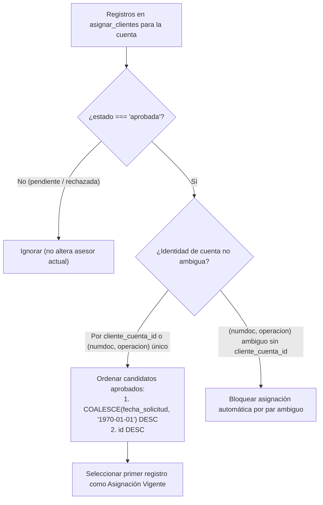

# KP INVEST CRM V3 — INFORME DE IMPLEMENTACIÓN DEL MÓDULO ASIGNACIÓN DE CLIENTES

**Fecha:** 04 de noviembre de 2026  
**Proyecto:** `C:\GitHub\KP-CRM-Meridian-ui`  
**Rama:** `feature/meridian-ui-v3`  
**Entorno de validación:** Docker local (`http://localhost:8091`), Base de pruebas aislada `kp_crm_testing`  
**Estado de Base Histórica (`kp_crm_revision_v3`):** Intacta (`276,158` registros en `asignar_clientes`, `0` modificaciones)

---

## 1. Resumen Ejecutivo

Se ha completado la transformación integral del módulo de **Asignación de Clientes** en el CRM Meridian V3, evolucionando la tabla `asignar_clientes` de una asignación plana por sobrescritura (`UNIQUE (numdoc, operacion)`) a un **historial lineal inmutable de asignaciones y solicitudes por cliente y operación**.

### Logros principales:
1. **Esquema e Historial Lineal:** Creación de la migración reversible [`2026_11_04_000005_transform_asignar_clientes_to_linear_history.php`](file:///C:/GitHub/KP-CRM-Meridian-ui/database/migrations/2026_11_04_000005_transform_asignar_clientes_to_linear_history.php), que amplía `numdoc` a `VARCHAR(30)`, elimina el índice único restrictivo `unique_asignacion_cliente`, incorpora las columnas de flujo (`cliente_cuenta_id`, `solicitante_user_id`, `asesor_destino_user_id`, `fecha_solicitud`, `motivo`, `estado`, `aprobado_por_user_id`, `fecha_aprobacion`, `observacion_resolucion`, `origen`, `created_at`, `updated_at`), claves foráneas con `ON DELETE SET NULL` e índices compuestos para consulta eficiente de asignación vigente.
2. **Conservación de Registros Históricos:** Respaldo previo en [`backup_asignar_clientes_pre_v3.sql`](file:///C:/GitHub/KP-CRM-Meridian-ui/database/backup_asignar_clientes_pre_v3.sql). Los registros históricos conservan su validez (`estado = 'aprobada'`), vinculándose automáticamente a `users.id` únicamente cuando el nombre normalizado del asesor es único en `users` y manteniendo `NULL` sin inventar usuarios cuando corresponde a bolsas o carteras históricas (`BOLSA`, `ESCALL`, `MONTOS=<250`, `FALLECIDO`).
3. **Regla Centralizada de Asignación Vigente:** Implementación de [`ClienteAssignmentService`](file:///C:/GitHub/KP-CRM-Meridian-ui/app/Services/Asignacion/ClienteAssignmentService.php) que determina el asesor vigente filtrando exclusivamente `estado = 'aprobada'`, agrupando por identidad real de cuenta (`cliente_cuenta_id` o `numdoc + operacion` no ambiguo) y seleccionando el registro con mayor `fecha_solicitud` (desempate por mayor `id`).
4. **Flujo 1 — Solicitud Manual desde Ficha 360°:** Incorporación del botón **Solicitar asignación**, modal Meridian [`create-modal.blade.php`](file:///C:/GitHub/KP-CRM-Meridian-ui/resources/views/components/asignaciones/create-modal.blade.php) con motivo obligatorio y confirmación explícita, creación granular de un registro `pendiente` por cada operación seleccionada y panel de trazabilidad [`history-panel.blade.php`](file:///C:/GitHub/KP-CRM-Meridian-ui/resources/views/components/asignaciones/history-panel.blade.php).
5. **Flujo 2 — Bandeja de Autorizaciones (`ASIGNAR CLIENTE`):** Nueva sección paginada y filtrable en [`autorizacion/index.blade.php`](file:///C:/GitHub/KP-CRM-Meridian-ui/resources/views/autorizacion/index.blade.php) con modal de detalle y trazabilidad por operación, y acciones **Aprobar** / **Rechazar** habilitadas en backend (`Policy` + `Gate` + middleware) para **Administrador, Supervisor y Soporte** (bloqueado con `403 Forbidden` para **Asesor**).
6. **Flujo 3 — Carga Masiva (`Integración -> Subir Asignación`):** Rediseño de [`AsignacionImport`](file:///C:/GitHub/KP-CRM-Meridian-ui/app/Imports/AsignacionImport.php) e [`IntegracionAsignacionController`](file:///C:/GitHub/KP-CRM-Meridian-ui/app/Http/Controllers/IntegracionAsignacionController.php) con vista previa diagnóstica sin escritura en BD, detección de cuentas inexistentes o ambiguas, resolución no ambigua de asesores contra `users`, idempotencia ante recargas (`sin_cambio_efectivo`) y reporte CSV descargable de filas observadas.
7. **Suite de Pruebas:** Se pasó de la línea base de **114 pruebas (807 aserciones)** a **126 pruebas aprobadas y 971 aserciones** (`0` fallos).

---

## 2. Esquema Anterior vs Esquema Nuevo de `asignar_clientes`

### 2.1 Auditoría Inicial en `kp_crm_revision_v3`
- **Total de registros históricos:** `276,158`.
- **Distribución de valores históricos en `name`:**
  - Nombres que corresponden a un único usuario en `users`: `BKC` (`id=51`), `FINANCOBRO` (`id=28`), `JYC` (`id=26`), `CANCELADOS` (`id=20`), `SUSANA ALVARADO` (`id=47`), `LUPE BASURTO` (`id=8`, contenía espacio no separable `0xC2A0`), `AKEMY FLORES` (`id=4`), entre otros.
  - Etiquetas operativas sin usuario en `users`: `BOLSA` (`53,737`), `ESCALL` (`47,095`), `MONTOS=<250` (`6,859`), `FALLECIDO` (`272`).

### 2.2 Comparativa de Estructura Física

| Columna / Índice | Esquema Anterior | Esquema Nuevo (`asignar_clientes`) | Propósito |
| :--- | :--- | :--- | :--- |
| `id` | `BIGINT(20) UNSIGNED PK` | `BIGINT(20) UNSIGNED PK` | Identificador único y criterio de desempate cronológico |
| `numdoc` | `VARCHAR(20) NOT NULL` | `VARCHAR(30) NOT NULL` | Soporta DNI (con ceros iniciales), RUC, CE y PTP |
| `operacion` | `VARCHAR(50) NOT NULL` | `VARCHAR(50) NOT NULL` | Código de operación preservando ceros a la izquierda |
| `cliente_cuenta_id` | *(No existía)* | `BIGINT(20) UNSIGNED NULL` (FK `clientes_cuentas.id`) | Identidad física no ambigua de la cuenta |
| `name` | `VARCHAR(150) NOT NULL` | `VARCHAR(150) NULL` | Respaldo nominal para asignaciones históricas (`BOLSA`, etc.) |
| `solicitante_user_id` | *(No existía)* | `BIGINT(20) UNSIGNED NULL` (FK `users.id`) | Usuario que solicita o ejecuta la carga masiva |
| `asesor_destino_user_id` | *(No existía)* | `BIGINT(20) UNSIGNED NULL` (FK `users.id`) | Asesor asignado a la operación |
| `fecha_solicitud` | *(No existía)* | `DATETIME NULL` | Marca temporal canónica para determinar la asignación vigente |
| `motivo` | *(No existía)* | `TEXT NULL` | Motivo de solicitud manual o `'carga masiva'` |
| `estado` | *(No existía)* | `ENUM('pendiente','aprobada','rechazada') DEFAULT 'aprobada'` | Estado dentro del flujo de autorización |
| `aprobado_por_user_id` | *(No existía)* | `BIGINT(20) UNSIGNED NULL` (FK `users.id`) | Usuario que aprobó o rechazó la solicitud |
| `fecha_aprobacion` | *(No existía)* | `DATETIME NULL` | Fecha y hora de resolución |
| `observacion_resolucion` | *(No existía)* | `TEXT NULL` | Nota de aprobación o motivo obligatorio de rechazo |
| `origen` | *(No existía)* | `VARCHAR(30) NOT NULL DEFAULT 'carga_masiva'` | `'manual'` o `'carga_masiva'` |
| `created_at` / `updated_at` | *(No existían)* | `TIMESTAMP NULL` | Auditoría estándar Eloquent |
| `unique_asignacion_cliente` | `UNIQUE (numdoc, operacion)` | **Eliminado** | Permite múltiples registros históricos por operación |
| Índices de vigencia | Índices simples | `asignar_clientes_numdoc_operacion_vigente_idx`, `asignar_clientes_cuenta_vigente_idx`, `asignar_clientes_estado_fecha_idx` | Resolución rápida de asignación vigente y bandeja paginada |

---

## 3. Migración Creada y Procedimiento de Rollback

- **Archivo de migración:** [`database/migrations/2026_11_04_000005_transform_asignar_clientes_to_linear_history.php`](file:///C:/GitHub/KP-CRM-Meridian-ui/database/migrations/2026_11_04_000005_transform_asignar_clientes_to_linear_history.php)
- **Respaldo previo en testing:** [`database/backup_asignar_clientes_pre_v3.sql`](file:///C:/GitHub/KP-CRM-Meridian-ui/database/backup_asignar_clientes_pre_v3.sql)

### Comportamiento de `up()`:
1. Amplía `numdoc` a `VARCHAR(30) NOT NULL` y convierte `name` en `VARCHAR(150) DEFAULT NULL`.
2. Elimina el índice `unique_asignacion_cliente` si existe.
3. Agrega las 12 columnas de trazabilidad e historial lineal.
4. Crea los 6 índices de consulta y las 4 claves foráneas (`ON DELETE SET NULL`).
5. Ejecuta el mapeo retroactivo no ambiguo de `asesor_destino_user_id` cruzando `TRIM(UPPER(REPLACE(name, UNHEX('C2A0'), ' ')))` únicamente contra nombres de usuario que tienen cardinalidad exacta `COUNT(*) = 1` en `users`.

### Comportamiento de `down()` (Rollback verificado):
1. Elimina las 4 claves foráneas y los 6 índices agregados.
2. Elimina las 12 columnas de historial lineal.
3. Restaura `name VARCHAR(150) NOT NULL`.
4. Restaura `UNIQUE INDEX unique_asignacion_cliente (numdoc, operacion)` si no existen pares duplicados.

---

## 4. Regla de Asignación Vigente

Centralizada en [`ClienteAssignmentService::resolveActiveAssignmentsForAccounts()`](file:///C:/GitHub/KP-CRM-Meridian-ui/app/Services/Asignacion/ClienteAssignmentService.php#L33-L190):

- **Protección ante aprobaciones fuera de orden:** Si una solicitud antigua (`fecha_solicitud = 09:00`) se aprueba a las `10:30`, después de que una asignación más reciente (`fecha_solicitud = 10:00`) ya estaba aprobada, la asignación de las `10:00` **se mantiene como vigente** porque el ordenamiento evalúa `fecha_solicitud DESC, id DESC` y nunca `fecha_aprobacion DESC` ni `MAX(id)` aislado.
- **Consumidores conectados al servicio centralizado:**
  - [`ClienteAccountService::advisorsByOperation()`](file:///C:/GitHub/KP-CRM-Meridian-ui/app/Services/Cliente/ClienteAccountService.php#L42-L49) y [`addPaymentAndAdvisorData()`](file:///C:/GitHub/KP-CRM-Meridian-ui/app/Services/Cliente/ClienteAccountService.php#L51-L92) (Ficha 360°).
  - [`ClienteProfileService::show()`](file:///C:/GitHub/KP-CRM-Meridian-ui/app/Services/Cliente/ClienteProfileService.php#L21-L72).
  - [`AutorizacionIndexService::fromRequest()`](file:///C:/GitHub/KP-CRM-Meridian-ui/app/Services/Autorizacion/AutorizacionIndexService.php#L26-L89) (Bandeja de Autorizaciones).
  - [`AsignacionImport`](file:///C:/GitHub/KP-CRM-Meridian-ui/app/Imports/AsignacionImport.php#L254-L290) (Validación de `sin_cambio_efectivo` en carga masiva).

---

## 5. Flujo de Solicitud Manual desde Ficha 360°

1. **Interfaz en `/clientes/{numdoc}` ([`clientes/show.blade.php`](file:///C:/GitHub/KP-CRM-Meridian-ui/resources/views/clientes/show.blade.php#L57-L87)):**
   - En el encabezado de **CUENTAS DEL CLIENTE**, junto a **Generar propuesta**, se ubica el botón **Solicitar asignación** (`#btnSolicitarAsignacion`), que se habilita dinámicamente al marcar una o más operaciones (`.chkOp`).
   - Al pulsarlo, [`show.js`](file:///C:/GitHub/KP-CRM-Meridian-ui/resources/js/modules/clientes/show.js#L281-L355) sincroniza el resumen de operaciones seleccionadas en [`<x-asignaciones.create-modal>`](file:///C:/GitHub/KP-CRM-Meridian-ui/resources/views/components/asignaciones/create-modal.blade.php).
2. **Validación y Persistencia ([`ClienteController::storeAsignacion()`](file:///C:/GitHub/KP-CRM-Meridian-ui/app/Http/Controllers/ClienteController.php#L42-L73) y [`ClienteAssignmentService::requestManualAssignments()`](file:///C:/GitHub/KP-CRM-Meridian-ui/app/Services/Asignacion/ClienteAssignmentService.php#L228-L333)):**
   - Ruta: `POST /clientes/{numdoc}/asignaciones` (`clientes.asignaciones.store`).
   - Verifica bajo transacción y bloqueo `FOR UPDATE` que cada operación exista en `clientes_cuentas` para ese `numdoc`, que no sea ambigua y que el asesor no tenga ya una solicitud `pendiente` activa para esa misma operación.
   - Crea **un registro individual por cada operación seleccionada** con:
     - `solicitante_user_id = Auth::id()`
     - `asesor_destino_user_id = Auth::id()`
     - `fecha_solicitud = Carbon::now('America/Lima')`
     - `motivo` = motivo ingresado (obligatorio, mínimo 3 caracteres)
     - `estado = 'pendiente'`
     - `origen = 'manual'`
     - `aprobado_por_user_id = null`, `fecha_aprobacion = null`

---

## 6. Flujo de Aprobación / Rechazo en Autorizaciones

1. **Sección `ASIGNAR CLIENTE` en `/autorizacion` ([`autorizacion/index.blade.php`](file:///C:/GitHub/KP-CRM-Meridian-ui/resources/views/autorizacion/index.blade.php#L387-L619)):**
   - Conserva intactas las secciones **Promesas de pago** y **Solicitudes CNA**.
   - Incluye barra de filtros por `Estado` (`Pendientes` por defecto, `Aprobadas`, `Rechazadas`, `Todos`), `Documento / Operación`, `Solicitante`, `Asesor destino` y rango de fechas (`Desde` / `Hasta`).
   - Muestra por fila: Cliente (`nombre` y `numdoc`), Operación / Cuenta, Entidad / Producto, Solicitante, Asesor destino (y asesor vigente actual), Fecha de solicitud, Motivo / Origen, Estado y Acciones (**Detalle**, **Aprobar**, **Rechazar**).
2. **Modal de Detalle (`#modalAsignacionFicha`):**
   - Muestra deuda capital, deuda total, entidad, producto, cosecha, cuenta, asesor vigente actual, motivo, resolución y la tabla del **historial lineal de asignaciones de esa operación**.
3. **Resolución Transaccional ([`AutorizacionController`](file:///C:/GitHub/KP-CRM-Meridian-ui/app/Http/Controllers/AutorizacionController.php#L36-L97)):**
   - **Aprobar (`POST /autorizacion/asignaciones/{asignacion}/aprobar`):** Bloquea la fila (`lockForUpdate()`), verifica que `estado === 'pendiente'`, actualiza `estado = 'aprobada'`, `aprobado_por_user_id = Auth::id()`, `fecha_aprobacion = now()`, `observacion_resolucion`, e invalida el caché del Dashboard mediante `PanelDashboardService::invalidate()`.
   - **Rechazar (`POST /autorizacion/asignaciones/{asignacion}/rechazar`):** Exige motivo obligatorio, verifica que `estado === 'pendiente'`, actualiza `estado = 'rechazada'`, `aprobado_por_user_id = Auth::id()`, `fecha_aprobacion = now()`, `observacion_resolucion = $motivo`, sin alterar el asesor vigente de la cuenta.

---

## 7. Flujo de Carga Masiva en Subir Asignación

En [`AsignacionImport.php`](file:///C:/GitHub/KP-CRM-Meridian-ui/app/Imports/AsignacionImport.php), [`IntegracionAsignacionController.php`](file:///C:/GitHub/KP-CRM-Meridian-ui/app/Http/Controllers/IntegracionAsignacionController.php) y [`integracion-asignacion.blade.php`](file:///C:/GitHub/KP-CRM-Meridian-ui/resources/views/placeholders/integracion-asignacion.blade.php):

1. **Vista Previa Diagnóstica (`POST /integracion/asignacion/preview`):**
   - Evalúa el archivo CSV sin escribir en la base de datos y presenta tarjetas con métricas desglosadas:
     - `nuevas_asignaciones`
     - `sin_cambio_efectivo`
     - `cuenta_inexistente` + `cuenta_ambigua`
     - `asesor_invalido` (inexistente o ambiguo en `users`)
     - `duplicados` (filas repetidas dentro del mismo CSV)
2. **Reporte Descargable (`GET /integracion/asignacion/errores`):**
   - Genera `reporte_observaciones_asignacion.csv` con `Fila`, `NUMDOC`, `OPERACION`, `ASESOR`, `Categoría` y `Motivo`.
3. **Ejecución Atómica e Idempotente (`POST /integracion/asignacion/import`):**
   - Protegida con bloqueo exclusivo de archivo (`asignacion_import.lock`) y `DB::transaction()`.
   - Si el asesor vigente de la cuenta ya coincide con el asesor del CSV, la fila se contabiliza como `sin_cambio_efectivo` sin duplicar registros en `asignar_clientes`.
   - Cada cambio efectivo inserta un nuevo registro en `asignar_clientes` con `solicitante_user_id = Auth::id()`, `asesor_destino_user_id = $user->id`, `fecha_solicitud = $now`, `motivo = 'carga masiva'`, `estado = 'aprobada'`, `aprobado_por_user_id = Auth::id()`, `fecha_aprobacion = $now`, `origen = 'carga_masiva'`.

---

## 8. Matriz de Permisos por Rol e Inmutabilidad CRUD

| Acción / Operación | Administrador | Supervisor | Soporte | Asesor | Protección Backend |
| :--- | :---: | :---: | :---: | :---: | :--- |
| Solicitar asignación desde Ficha 360° | Sí | Sí | Sí | Sí | `Gate: create-cliente-asignacion` |
| Ver bandeja `ASIGNAR CLIENTE` (`/autorizacion`) | Sí | Sí | Sí | **No (`403`)** | Middleware `role:administrador,supervisor,soporte` + `AsignacionPolicy` |
| Aprobar solicitud de asignación | Sí | Sí | Sí | **No (`403`)** | `Gate: approve-asignacion` |
| Rechazar solicitud de asignación | Sí | Sí | Sí | **No (`403`)** | `Gate: reject-asignacion` |
| Aprobar / Rechazar Promesas y CNA | Sí | Sí (Preaprobar/Rechazar) | **No (`403`)** | **No (`403`)** | Middleware `role:administrador,supervisor` + `PromesaPolicy` / `CnaPolicy` |
| Subir carga masiva de asignaciones | Sí | Sí | Sí | **No (`403`)** | `Gate: access-integracion` |
| Editar asignación ya aprobada o rechazada | **Prohibido** | **Prohibido** | **Prohibido** | **Prohibido** | Guard en `AsignarCliente::updating()` lanza `DomainException` |
| Eliminar físicamente registros de asignación | **Prohibido** | **Prohibido** | **Prohibido** | **Prohibido** | Guard en `AsignarCliente::deleting()` lanza `DomainException` |

---

## 9. Archivos Creados o Modificados

### Archivos Nuevos:
- [`database/migrations/2026_11_04_000005_transform_asignar_clientes_to_linear_history.php`](file:///C:/GitHub/KP-CRM-Meridian-ui/database/migrations/2026_11_04_000005_transform_asignar_clientes_to_linear_history.php)
- [`app/Policies/AsignacionPolicy.php`](file:///C:/GitHub/KP-CRM-Meridian-ui/app/Policies/AsignacionPolicy.php)
- [`app/Services/Asignacion/ClienteAssignmentService.php`](file:///C:/GitHub/KP-CRM-Meridian-ui/app/Services/Asignacion/ClienteAssignmentService.php)
- [`resources/views/components/asignaciones/create-modal.blade.php`](file:///C:/GitHub/KP-CRM-Meridian-ui/resources/views/components/asignaciones/create-modal.blade.php)
- [`resources/views/components/asignaciones/history-panel.blade.php`](file:///C:/GitHub/KP-CRM-Meridian-ui/resources/views/components/asignaciones/history-panel.blade.php)
- [`tests/Feature/ClienteAssignmentModuleTest.php`](file:///C:/GitHub/KP-CRM-Meridian-ui/tests/Feature/ClienteAssignmentModuleTest.php)
- [`database/backup_asignar_clientes_pre_v3.sql`](file:///C:/GitHub/KP-CRM-Meridian-ui/database/backup_asignar_clientes_pre_v3.sql)

### Archivos Modificados:
- [`app/Models/AsignarCliente.php`](file:///C:/GitHub/KP-CRM-Meridian-ui/app/Models/AsignarCliente.php)
- [`app/Support/Authorization/Roles.php`](file:///C:/GitHub/KP-CRM-Meridian-ui/app/Support/Authorization/Roles.php)
- [`app/Providers/AuthServiceProvider.php`](file:///C:/GitHub/KP-CRM-Meridian-ui/app/Providers/AuthServiceProvider.php)
- [`app/Services/Cliente/ClienteAccountService.php`](file:///C:/GitHub/KP-CRM-Meridian-ui/app/Services/Cliente/ClienteAccountService.php)
- [`app/Services/Cliente/ClienteProfileService.php`](file:///C:/GitHub/KP-CRM-Meridian-ui/app/Services/Cliente/ClienteProfileService.php)
- [`app/ViewModels/Cliente/ClienteShowViewModel.php`](file:///C:/GitHub/KP-CRM-Meridian-ui/app/ViewModels/Cliente/ClienteShowViewModel.php)
- [`app/Http/Controllers/ClienteController.php`](file:///C:/GitHub/KP-CRM-Meridian-ui/app/Http/Controllers/ClienteController.php)
- [`app/Http/Controllers/AutorizacionController.php`](file:///C:/GitHub/KP-CRM-Meridian-ui/app/Http/Controllers/AutorizacionController.php)
- [`app/Services/Autorizacion/AutorizacionIndexService.php`](file:///C:/GitHub/KP-CRM-Meridian-ui/app/Services/Autorizacion/AutorizacionIndexService.php)
- [`app/ViewModels/Autorizacion/AutorizacionIndexViewModel.php`](file:///C:/GitHub/KP-CRM-Meridian-ui/app/ViewModels/Autorizacion/AutorizacionIndexViewModel.php)
- [`app/Imports/AsignacionImport.php`](file:///C:/GitHub/KP-CRM-Meridian-ui/app/Imports/AsignacionImport.php)
- [`app/Http/Controllers/IntegracionAsignacionController.php`](file:///C:/GitHub/KP-CRM-Meridian-ui/app/Http/Controllers/IntegracionAsignacionController.php)
- [`routes/web/clientes.php`](file:///C:/GitHub/KP-CRM-Meridian-ui/routes/web/clientes.php)
- [`routes/web/promesas.php`](file:///C:/GitHub/KP-CRM-Meridian-ui/routes/web/promesas.php)
- [`routes/web/integracion.php`](file:///C:/GitHub/KP-CRM-Meridian-ui/routes/web/integracion.php)
- [`resources/views/clientes/show.blade.php`](file:///C:/GitHub/KP-CRM-Meridian-ui/resources/views/clientes/show.blade.php)
- [`resources/views/autorizacion/index.blade.php`](file:///C:/GitHub/KP-CRM-Meridian-ui/resources/views/autorizacion/index.blade.php)
- [`resources/views/placeholders/integracion-asignacion.blade.php`](file:///C:/GitHub/KP-CRM-Meridian-ui/resources/views/placeholders/integracion-asignacion.blade.php)
- [`resources/views/components/layout/sidebar.blade.php`](file:///C:/GitHub/KP-CRM-Meridian-ui/resources/views/components/layout/sidebar.blade.php)
- [`resources/js/modules/clientes/show.js`](file:///C:/GitHub/KP-CRM-Meridian-ui/resources/js/modules/clientes/show.js)
- [`resources/js/modules/autorizacion/index.js`](file:///C:/GitHub/KP-CRM-Meridian-ui/resources/js/modules/autorizacion/index.js)
- [`tests/Feature/V3RoleAccessTest.php`](file:///C:/GitHub/KP-CRM-Meridian-ui/tests/Feature/V3RoleAccessTest.php)
- [`tests/Feature/IntegralFunctionalAuditP13Test.php`](file:///C:/GitHub/KP-CRM-Meridian-ui/tests/Feature/IntegralFunctionalAuditP13Test.php)
- [`tests/Feature/V3WorkflowSmokeTest.php`](file:///C:/GitHub/KP-CRM-Meridian-ui/tests/Feature/V3WorkflowSmokeTest.php)

---

## 10. Resultados Completos de Pruebas y Aserciones

Ejecución realizada exclusivamente contra `kp_crm_testing`:

| Suite de Pruebas | Estado | Pruebas | Aserciones |
| :--- | :---: | :---: | :---: |
| `Tests\Feature\ClienteAssignmentModuleTest` *(Nueva)* | **PASS** | 12 | 164 |
| `Tests\Feature\StructuralCleanupTest` | **PASS** | 3 | 30 |
| `Tests\Feature\DatabaseStandardizationNumdocTest` | **PASS** | 5 | 47 |
| `Tests\Feature\IntegralFunctionalAuditP13Test` | **PASS** | 18 | 195 |
| `Tests\Feature\DataImportReconciliationFaseCTest` | **PASS** | 25 | 109 |
| `Tests\Feature\DashboardOptimizationFaseBTest` | **PASS** | 14 | 70 |
| `Tests\Feature\FrontendOptimizationFaseDTest` | **PASS** | 5 | 83 |
| `Tests\Feature\SqlOptimizationFaseATest` | **PASS** | 4 | 25 |
| `Tests\Feature\SecurityP0RemediationTest` | **PASS** | 7 | 31 |
| `Tests\Feature\SecurityP1FunctionalTest` | **PASS** | 8 | 36 |
| Suites Base V3 (`Unit` + `Feature` V3) | **PASS** | 25 | 181 |
| **TOTAL ACUMULADO** | **PASS** | **126 aprobadas** | **971 aserciones** |

---

## 11. Riesgos Residuales y Recomendaciones Antes de Migrar Datos Reales

1. **Etiquetas Operativas en Registros Históricos (`BOLSA`, `ESCALL`, `MONTOS=<250`, `FALLECIDO`):**
   - En la base histórica `kp_crm_revision_v3`, existen `107,963` registros cuyo campo `name` contiene etiquetas operativas de cartera (`BOLSA`, `ESCALL`, etc.) que no corresponden a usuarios en la tabla `users`.
   - Gracias a que el esquema físico mantiene `asesor_destino_user_id NULL` y conserva la columna `name` como fallback de lectura en `AsignarCliente::getAsesorNombreAttribute()`, estos registros seguirán mostrándose exactamente igual en la Ficha 360° sin perder información histórica.
   - Si en el futuro se desea asignar masivamente a `BOLSA` o `ESCALL` mediante archivo CSV, se recomienda crear usuarios operativos dedicados en `users` para dichas etiquetas o mantenerlas como estados de cartera.
2. **Espacios No Separables (`0xC2A0`) en `users.name`:**
   - La auditoría detectó que el usuario `LUPE BASURTO` (`id = 8`) tiene un carácter `0xC2A0` (non-breaking space) en `users.name`. Tanto la migración como `AsignacionImport` y el modelo `AsignarCliente` normalizan `0xC2A0` a espacio estándar (`0x20`), evitando falsos rechazos. Se recomienda limpiar los espacios `0xC2A0` en `users.name` durante la ventana de despliegue.
3. **Tiempo de Ejecución de `ALTER TABLE` sobre 276,158 Filas:**
   - En el entorno local sobre los `276,158` registros respaldados, la migración `2026_11_04_000005_transform_asignar_clientes_to_linear_history` se ejecutó en `< 1.5 segundos`. Aun así, en producción se recomienda ejecutarla dentro de una ventana de mantenimiento con backup previo (`mysqldump`).
