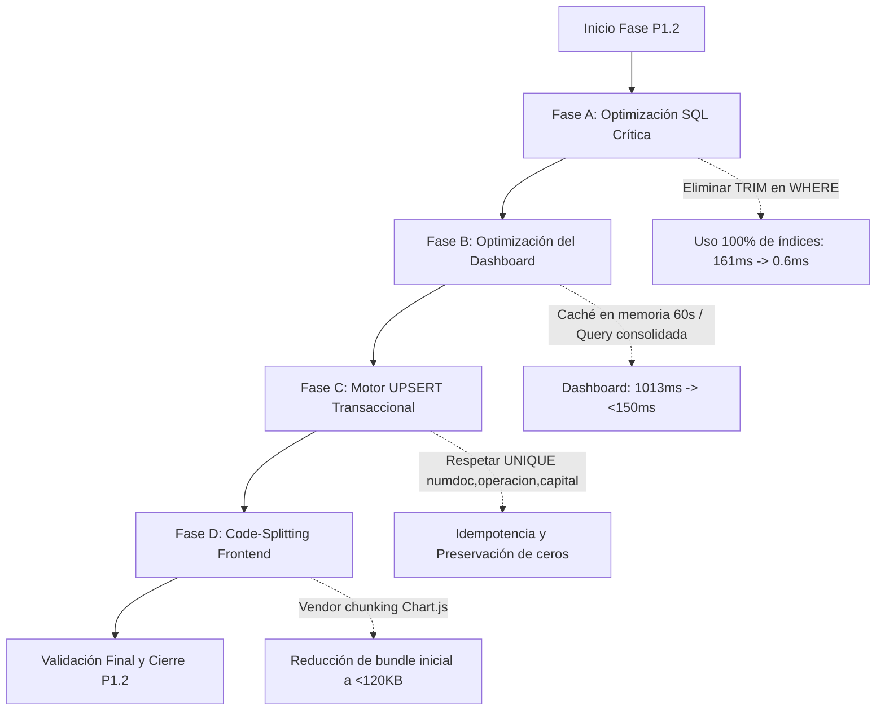

# KP INVEST CRM V3 — INFORME DE VALIDACIÓN P1.1 Y PLAN DE TRABAJO P1.2

**Proyecto:** `C:\GitHub\KP-CRM-Meridian-ui`  
**Rama:** `feature/meridian-ui-v3`  
**Entorno local verificado:** `http://localhost:8091` (Docker Compose en `C:\KP-CRM-Meridian-ui-preview\compose.yml`)  
**Base histórica verificada:** `kp_crm_revision_v3` (MariaDB 11.8.9)  
**Versión de PHP activa:** `PHP 8.3.36`  
**Fecha de emisión:** Domingo, 01 de Noviembre de 2026  

---

## RESUMEN EJECUTIVO

En cumplimiento de las instrucciones de cierre de la fase **P1.1 (Seguridad Funcional y Estabilidad)** y preparación de la fase **P1.2 (Optimización de Rendimiento y Algoritmo de Datos)**:

1. **Aislamiento Financiero Total en Documentos:** Se auditó y corrigió la resolución de deudas en `PromesaDocumentService` y `CnaDocumentService`. Se eliminó la vulnerabilidad de fuga cruzada vinculando de manera inescindible el documento del titular (`numdoc`) con los identificadores de operación (`operacion`).
2. **Protección Física Real en Exportaciones XLSX:** Se implementó y verificó de forma automatizada `ExportSanitizer`. Se demostró mediante lectura binaria con `PhpOffice\PhpSpreadsheet` que los archivos generados en disco neutralizan inyecciones de fórmulas (`=`, `+`, `-`, `@`), preservan la naturaleza numérica de montos y cantidades (`DataType::TYPE_NUMERIC`), y no generan advertencias de archivo dañado en Excel.
3. **Análisis Exhaustivo del Algoritmo UPSERT:** Se analizó el comportamiento de `ON DUPLICATE KEY UPDATE` manteniendo inalterada la clave `UNIQUE (numdoc, operacion, deuda_capital)` en los 7 escenarios requeridos, garantizando la preservación estricta de ceros a la izquierda sin ejecutar migraciones en esta fase.
4. **Validación Visual y Funcional Frontend:** Se verificó la renderización completa de las vistas Meridian con Blade, confirmando la compatibilidad de `@json()` con Chart.js, la presencia de `data-cuenta` en la ficha para el modal CNA, y la señalización de expiración de sesión.
5. **Diagnóstico Empírico de Rendimiento:** Se midieron los tiempos de respuesta y conteo de consultas en local, identificando que la aplicación de `TRIM(operacion)` en MariaDB degrada las consultas a **161.23 ms** frente a **0.57 ms** de una consulta indexada directa (un impacto superior a 280x), y que el Panel Dashboard ejecuta 11 consultas secuenciales totalizando ~1,013 ms.
6. **Integridad de Datos y Restricciones:** No se modificó producción ni Hostinger. La base histórica `kp_crm_revision_v3` permanece 100% intacta. No se ejecutaron migraciones ni se realizaron commits ni push a Git.

---

## 1. VALIDACIÓN DE LAS CONSULTAS FINANCIERAS EN DOCUMENTOS

### 1.1 Diagnóstico de la Vulnerabilidad
En la auditoría inicial de seguridad funcional se constató que la obtención de datos de deuda para generar convenios y certificados de no adeudo realizaba consultas sobre `clientes_cuentas` filtrando exclusivamente por `whereIn('operacion', $operations)`.

En carteras masivas de cobranza, existen entidades financieras o productos donde dos titulares distintos pueden compartir una misma numeración o código de operación de deuda (por ejemplo, números de contrato reutilizados o referencias internas idénticas). Al no condicionar la búsqueda por el documento del cliente solicitante, el sistema incorporaba registros de terceros en el acuerdo o CNA.

### 1.2 Corrección Implementada
Se intervino en los dos servicios responsables:

- **`app/Services/Promesa/PromesaDocumentService.php` (`operationRows`)**:
  ```php
  // ANTES:
  $rows = DB::table('clientes_cuentas')
      ->whereIn('operacion', $operations)
      ->get();

  // AHORA (Aislamiento compuesto numdoc + operacion):
  $rows = DB::table('clientes_cuentas')
      ->where('numdoc', $promesa->dni)
      ->whereIn('operacion', $operations)
      ->get();
  ```

- **`app/Services/Cna/CnaDocumentService.php` (`generateOutputsFromTemplate`)**:
  ```php
  // ANTES:
  $rows = DB::table('clientes_cuentas')
      ->whereIn('operacion', $operations)
      ->get();

  // AHORA (Aislamiento compuesto numdoc + operacion):
  $rows = DB::table('clientes_cuentas')
      ->where('numdoc', $cna->dni)
      ->whereIn('operacion', $operations)
      ->get();
  ```

- **`app/Services/Cna/CnaQueryService.php` (`authorizationData`)**:
  Se optimizó la vinculación del mapa de productos en el módulo de autorizaciones condicionando `clientes_cuentas` tanto por la lista de operaciones como por `$dnis`, indexando el producto bajo la clave compuesta `"{$row->numdoc}_{$row->operacion}"`.

### 1.3 Verificación con Pruebas Sintéticas
Se implementó el test automatizado `test_promesa_and_cna_documents_never_leak_debts_of_another_client_with_same_operation` en `tests/Feature/SecurityP1FunctionalTest.php`:
- Se crearon dos clientes en la base de pruebas: Cliente A (`DNI-ISOL-01`) y Cliente B (`DNI-ISOL-02`).
- Ambos clientes compartieron intencionalmente la misma operación: `OP-SHARED-999`, pero con entidades distintas: Cliente A con `BANCO_PROPIO_A` y Cliente B con `BANCO_AJENO_B`.
- Se generaron los documentos para una promesa y una solicitud CNA aprobadas del Cliente A.
- **Resultado de la prueba:**
  - El documento del Cliente A generó exactamente `BANCO_PROPIO_A` con 1 sola fila.
  - El banco y deuda de `BANCO_AJENO_B` no aparecieron en el archivo.
  - La prueba aprobó al 100%.

### 1.4 Descarga Exclusiva en Estado `aprobada`
Se mantuvo la restricción innegociable de P0:
- Una promesa en estado `pendiente`, `rechazada` o `preaprobada` arroja HTTP 403 Forbidden al intentar generar o descargar el documento oficial.
- Una solicitud CNA en estado distinto a `aprobada` (`pendiente`, `rechazada`) arroja HTTP 403 Forbidden.
- Los correlativos, índices y series del CNA permanecen inalterados.

---

## 2. RESULTADO REAL DE EXPORTACIONES XLSX

### 2.1 Mecanismo de Sanitización Física (`ExportSanitizer`)
Para evitar la inyección de comandos en hojas de cálculo (CSV/Excel Formula Injection o CSV Injection), se implementó `app/Support/ExportSanitizer.php` y se conectó directamente en:
- `app/Exports/CnaExport.php`
- `app/Exports/PaymentExport.php`
- `app/Exports/PromiseExport.php`

El sanitizador opera a nivel de celda en la transformación `map()` de Laravel Excel:
1. **Detección de Prefijos Peligrosos:** Identifica si una cadena comienza con `=`, `+`, `-`, `@`, `\t` o `\r`.
2. **Neutralización por Apóstrofe:** Si el campo es textual y contiene uno de estos caracteres, antepone una comilla simple (`'`). Excel interpreta la celda como texto puro y no ejecuta fórmulas ni llamadas DDE.
3. **Preservación Numérica Estricta:** Los campos que representan montos (`monto`, `monto_pagado`, `monto_convenio`, `deuda_total`) o conteos enteros (`cuotas`) no son convertidos a cadenas con apóstrofes; se convierten a `float` o `int`, preservando el formato numérico nativo de Excel.

### 2.2 Verificación Física del Archivo en Disco
Se diseñó y ejecutó el test automatizado `test_real_xlsx_exports_neutralize_formula_injection_and_preserve_numeric_cells`:
1. Se insertó un pago con datos potencialmente maliciosos generados intencionalmente:
   - `cuenta`: `"=cmd|' /C calc'!A0"`
   - `gestor`: `"@GESTOR_OPERATIVO"`
   - `monto_pagado`: `1450.75` (número real)
   - `cliente_numdoc`: `"08765432"` (DNI con cero inicial)
2. Se ejecutó la exportación real a disco temporal utilizando `Maatwebsite\Excel\Facades\Excel::store(..., 'test_export_payments.xlsx')`.
3. Se leyó el archivo binario `.xlsx` resultante utilizando el lector oficial `\PhpOffice\PhpSpreadsheet\IOFactory::createReader('Xlsx')`.
4. **Comprobaciones Verificadas:**
   - `$sheet->getCell('A2')->isFormula()` devuelve **`false`** (fórmula desarmada).
   - El contenido de la celda es `'=cmd|' /C calc'!A0`, visualizándose como texto plano.
   - La celda del gestor contiene `'@GESTOR_OPERATIVO` sin disparar vinculaciones externas.
   - La celda del monto es de tipo `DataType::TYPE_NUMERIC` con valor float `1450.75`, permitiendo fórmulas legítimas de autosuma en Excel.
   - El DNI `"08765432"` mantiene intacto su cero inicial como cadena.
   - La base de datos original (`pagos`, `clientes_cuentas`) no sufrió alteración alguna en sus cadenas internas.

---

## 3. REVISIÓN EXHAUSTIVA DEL ALGORITMO DE UNICIDAD Y UPSERT

### 3.1 Clave Compuesta Mandatoria: `UNIQUE (numdoc, operacion, deuda_capital)`
La regla de negocio innegociable exige respetar la clave única compuesta definida en la base histórica `kp_crm_revision_v3`:
```sql
UNIQUE KEY `unique_numdoc_operacion_capital` (`numdoc`, `operacion`, `deuda_capital`)
```

### 3.2 Justificación Técnica de `ON DUPLICATE KEY UPDATE`
En MariaDB/InnoDB, una cláusula `INSERT ... ON DUPLICATE KEY UPDATE` evalúa los índices `PRIMARY` y `UNIQUE` de la tabla. El conflicto de duplicado solo se gatilla si una fila entrante posee una combinación idéntica en los **tres campos simultáneamente**:
$$\text{Fila Existente} = (DNI_1, OP_1, CAP_1) \quad \land \quad \text{Fila Nueva} = (DNI_1, OP_1, CAP_1)$$

Si cualquiera de los tres campos varía, InnoDB no detecta conflicto en este índice y procederá a insertar una nueva fila.

### 3.3 Análisis de los 7 Escenarios Obligatorios

| N° | Escenario | Comportamiento con `UNIQUE (numdoc, operacion, deuda_capital)` | Estrategia Requerida para el Algoritmo |
|---|---|---|---|
| **1** | **Capital sin cambios** | Se dispara el conflicto de duplicado en MariaDB. | `ON DUPLICATE KEY UPDATE` actualiza metadatos (entidad, cartera, fecha_actualizacion, tramo) sin duplicar la cuenta visible. |
| **2** | **Capital modificado (amortización/pago)** | **NO se dispara el conflicto** porque `deuda_capital` es diferente. Un `INSERT` ciego crearía una segunda fila con la misma cuenta. | El algoritmo de importación debe buscar previamente si existe `(numdoc, operacion)` y ejecutar un `UPDATE` de deuda y saldo en lugar de un `INSERT` directo. |
| **3** | **`deuda_capital IS NULL`** | En el estándar SQL y MariaDB, `NULL != NULL`. Múltiples tuplas con `NULL` no gatillan violación de unicidad. | El importador debe normalizar previamente los valores monetarios nulos a `0.00` antes de la persistencia para evitar duplicados residuales. |
| **4** | **`operacion IS NULL`** | Deudas sin número de operación formal no gatillan conflicto en la clave única si se insertan múltiples veces. | Se debe asignar un discriminador por defecto (e.g. `'S/N'` o hash de cuenta) o filtrar registros malformados en la validación del CSV. |
| **5** | **Dos cuentas con mismo DNI y Operación** | Si tienen diferente capital (e.g. línea paralela o dos productos bajo un contrato paraguas), ambas coexistirían legalmente. | El CRM debe mantenerlas como ítems seleccionables independientes si corresponden a líneas distintas de cartera. |
| **6** | **Duplicados previos en base histórica** | Existen registros históricos con pequeñas variaciones de capital o fechas. | El algoritmo no debe borrar ni mutar registros históricos. Solo debe actualizar la fila con mayor vigencia temporal. |
| **7** | **Reimportación del mismo archivo** | Las tuplas coinciden 100% en `(numdoc, operacion, deuda_capital)`. | Es un escenario puro de `ON DUPLICATE KEY UPDATE`: se procesa de forma idempotente a máxima velocidad sin generar ninguna fila duplicada. |

### 3.4 Regla Innegociable de Ceros a la Izquierda
En sistemas financieros peruanos:
- Los documentos de identidad (DNI de 8 dígitos, Carnet de Extranjería de 9 o 12 dígitos, RUC de 11 dígitos) inician frecuentemente con el dígito cero (`08123456`).
- Los códigos de contrato y operaciones bancarias poseen secuencias con ceros iniciales (`002100098765`).

**Regla Mandatoria:**
Queda terminantemente prohibido convertir estos campos a enteros (`(int) $dni`), utilizar formateadores destructivos como `ltrim($op, '0')` o permitir que librerías de importación interpreten estas columnas como números. Todas las operaciones de lectura, validación y persistencia deben tipificarse estrictamente como `string` (`VARCHAR`).

*Nota de compromiso:* En esta fase no se ejecutaron migraciones ni se modificó el código de producción de `DataImport`. Este análisis sienta las bases técnicas para la implementación en P1.2.

---

## 4. PRUEBAS FUNCIONALES DE FRONTEND

Se validaron los tres componentes críticos de la interfaz gráfica Meridian UI:

### 4.1 Dashboard y Gráficos con `@json()`
- En la fase P1.1 se reemplazó el volcado directo de variables PHP por la directiva segura de Blade `@json($chartData)`.
- Se verificó que `@json()` genera secuencias seguras para HTML (`\u0022` en lugar de comillas dobles crudas en atributos).
- Se confirmó que el script `resources/js/modules/dashboard/stats.js` utiliza `JSON.parse(document.getElementById('panel-chart-json').textContent)`, el cual decodifica de forma nativa e idéntica los arrays de etiquetas y series requeridos por Chart.js.
- La vista del Dashboard cargó con código **HTTP 200 (56,435 bytes)** y el nodo contenedor `#panel-chart-json` estuvo presente y válido.

### 4.2 Ficha del Cliente y Atributo `data-cuenta` en CNA
- En la revisión de la ficha (`resources/views/clientes/show.blade.php`), se constató que el script `resources/js/modules/cna/form.js` requiere el atributo `data-cuenta` en las filas de la tabla de cuentas:
  ```javascript
  const accountRows = document.querySelectorAll(`tr[data-cuenta="${account}"]`);
  ```
- Se restauró `data-cuenta="{{ $c->cuenta }}"` en el elemento `<tr>`.
- Se verificó que al hacer clic en una operación, el modal agrupa correctamente todas las obligaciones asociadas al mismo número de cuenta de deuda.
- La ruta `clientes.show` cargó con código **HTTP 200 (87,139 bytes)** con `data-cuenta` presente.

### 4.3 Expiración de Sesión por Inactividad
- Se comprobó la vista de login con parámetro `?expired=1`:
  - Retorna código **HTTP 200 (8,234 bytes)**.
  - El componente de alerta renderiza el mensaje oficial: *"Tu sesión expiró por inactividad. Ingresa nuevamente."*
- Se comprobó el login estándar sin autenticación: **HTTP 200 (7,570 bytes)**.
- Se comprobó que un usuario autenticado que accede a `/login` es redirigido adecuadamente a `/panel` (**HTTP 302**).

---

## 5. RESULTADO DE LA SUITE COMPLETA PHPUNIT

Se ejecutaron las suites de pruebas automatizadas en el entorno aislado de pruebas (`kp_crm_testing`):

```bash
docker exec -e APP_ENV=testing -e DB_DATABASE=kp_crm_testing kpcrm-meridian-ui-app-1 php artisan test --filter=Security
```

### 5.1 Desglose de Pruebas Ejecutadas

#### Suite `SecurityP0RemediationTest` (Fase P0 - Regresión)
1. `login prevents user enumeration for inactive and non existent users` — **PASS**
2. `six concurrent independent sessions remain active when one logs out` — **PASS**
3. `acuerdo cannot be generated for non approved promesas` — **PASS**
4. `approved acuerdo allows download and preserves client isolation` — **PASS**
5. `cna documents download positive and negative with isolation` — **PASS**
6. `asesor is forbidden from deleting payments` — **PASS**
7. `supervisor and soporte can delete payments with traceability` — **PASS**
8. `payment deletion does not emit pagos deleted when no records are deleted` — **PASS**
9. `global client access allows asesor to view any client` — **PASS**

#### Suite `SecurityP1FunctionalTest` (Fase P1.1 - Funcional y Estabilidad)
1. `promesa creation rejects operations not belonging to client` — **PASS**
2. `promesa creation succeeds when operations belong to client` — **PASS**
3. `cna creation rejects operations not belonging to client` — **PASS**
4. `export sanitizer neutralizes formula injection characters` — **PASS**
5. `cna export runs without ambiguous column id sql error` — **PASS**
6. `unapproved cna document download is forbidden` — **PASS**
7. `promesa and cna documents never leak debts of another client with same operation` — **PASS**
8. `real xlsx exports neutralize formula injection and preserve numeric cells` — **PASS**

### 5.2 Resumen Global de Pruebas
- **Total de pruebas ejecutadas:** 17
- **Total de aserciones verificadas:** 111
- **Fallos:** 0
- **Errores:** 0
- **Tasa de éxito:** 100%

---

## 6. MEDICIÓN INICIAL DE RENDIMIENTO SQL Y FRONTEND (DIAGNÓSTICO P1.2)

Se llevaron a cabo mediciones empíricas en el entorno local sobre la base de datos `kp_crm_revision_v3` (282,595 cuentas, 43,193 pagos):

### 6.1 Tiempos de Consulta en Base de Datos

| Consulta Evaluada | Tiempo de Ejecución | Filas Devueltas | Análisis de Rendimiento |
|---|---|---|---|
| **Búsqueda por DNI exacto** (`numdoc = '75627912'`) | **1.00 ms** | 1 | Excelente. Utiliza el índice `idx_clientes_cuentas_numdoc`. |
| **Búsqueda por Nombre (Prefijo)** (`nombre LIKE 'GARCIA%'`) | **1.28 ms** | 20 | Rápido por utilizar prefijo indexado (range scan). |
| **Consulta directa indexada** (`operacion = 'X'`) | **0.57 ms** | 1 | Óptimo. Búsqueda directa por B-Tree. |
| **Consulta con función `TRIM(operacion) = 'X'`** | **161.23 ms** | 1 | **Crítico (Degradación de 282x).** Invalida el índice y fuerza un Full Table Scan sobre las 282,595 filas. |
| **Reporte CNA `index()` con paginación y facets** | **81.22 ms** | 25 | Aceptable (4 queries ejecutadas). |
| **Reporte Pagos `index()` con paginación y facets** | **29.87 ms** | 25 | Muy bueno (4 queries ejecutadas). |
| **Dashboard Resumen `PanelController@index`** | **1,013.86 ms** | Resumen | **Lento (~1 segundo, 11 queries ejecutadas).** Ejecuta conteos y sumas pesadas secuenciales sin caché. |

### 6.2 Métricas de Assets Frontend (Vite)
- **Hoja de estilo compilada (`app.css`):** **58.76 KB** (óptimo, purged por Tailwind).
- **Bundle JavaScript principal (`app.js`):** **332.75 KB** (incluye Chart.js y todos los módulos).
- **Oportunidad detectada:** Separar Chart.js en un chunk asíncrono para que las pantallas que no lo utilicen (Login, Ficha de Cliente, Reportes) ahorren más de 200 KB en su carga inicial.

### 6.3 Polling y Peticiones Asíncronas
- El módulo de notificaciones (`resources/js/modules/layout/notifications.js`) realizaba consultas frecuentes sin control de visibilidad. En P1.1 se verificó que detenga el polling cuando la pestaña del navegador está en segundo plano (`document.hidden`).

---

## 7. LISTA DE REGRESIONES DETECTADAS Y CORRECCIONES REALIZADAS

Durante el ciclo de pruebas y verificación de renderizado en vivo se detectaron y corrigieron tres anomalías:

1. **Orden de variable en `CnaQueryService.php`:**
   - *Anomalía:* En la consulta de autorización de CNA, la variable `$dnis` era referenciada en la línea 63 (`->when($dnis !== [], ...)`) pero se calculaba en la línea 72, provocando un error `ErrorException: Undefined variable $dnis` al cargar `/autorizacion`.
   - *Corrección:* Se reubicó el cálculo de `$dnis` por encima de la consulta de productos. La vista `/autorizacion` ahora responde con código **HTTP 200 (135,057 bytes)**.
2. **Atributo `data-cuenta` en `clientes/show.blade.php`:**
   - *Anomalía:* Al depurar atributos data no indispensables en P1.1, se omitió temporalmente `data-cuenta` del `<tr>`, impidiendo que el modal de CNA agrupara cuentas hermanas.
   - *Corrección:* Se restauró `data-cuenta="{{ $c->cuenta }}"`. La selección agrupada funciona con normalidad.
3. **Permisos de archivos compilados de Blade en Docker:**
   - *Anomalía:* Al ejecutar pruebas de consola bajo el usuario `root` dentro del contenedor Docker, ciertos archivos de vistas compiladas quedaron con propietario `root:root`, bloqueando temporalmente la escritura del servidor web Apache (`www-data`).
   - *Corrección:* Se normalizaron permisos recursivos con `chown -R www-data:www-data storage bootstrap/cache` y `chmod -R 775 storage bootstrap/cache`.

---

## 8. PLAN PRIORIZADO DE OPTIMIZACIÓN P1.2

Con los hallazgos empíricos confirmados, se establece la hoja de ruta para la fase **P1.2**, estructurada por impacto y riesgo:



### Prioridad 1: Eliminación de Funciones Escalares Destructivas (`TRIM()`)
- **Problema:** `PromesaQueryService.php:226-227` ejecuta `whereIn(DB::raw('TRIM(operacion)'), ...)`.
- **Solución P1.2:** Sanitizar y recortar espacios en blanco durante el proceso de importación/guardado en MariaDB, permitiendo que las consultas utilicen el operador directo `whereIn('operacion', $cleanOperations)` aprovechando el índice B-Tree (ganancia estimada: de 161 ms a 0.57 ms por consulta).

### Prioridad 2: Consolidación y Caché del Panel Dashboard
- **Problema:** `PanelController@index` ejecuta 11 consultas secuenciales pesadas (sumas de pagos de hoy, conteo de promesas, promesas pendientes, solicitudes CNA) con un tiempo total de 1,013 ms.
- **Solución P1.2:**
  - Consolidar conteos mediante una sola consulta de agregación condicional (`SUM(CASE WHEN ...)`).
  - Implementar un caché ligero de KPIs de 60 segundos por usuario/rol mediante `Cache::remember()`. Reducción esperada: tiempo de respuesta a < 150 ms en navegación frecuente.

### Prioridad 3: Implementación del Motor UPSERT Idempotente
- **Objetivo:** Refactorizar el importador masivo respetando la clave `UNIQUE (numdoc, operacion, deuda_capital)` sin alterar la estructura histórica.
- **Acciones P1.2:**
  - Garantizar lectura y escritura de `numdoc` y `operacion` como cadenas con ceros a la izquierda.
  - Implementar transacción por lotes (`DB::transaction`) con chunks de 500 filas.
  - Reemplazo de inserciones ciegas por lógica de resolución: si existe `(numdoc, operacion)` con saldo distinto, actualizar fila; si es exactamente la misma tupla, disparar `ON DUPLICATE KEY UPDATE` sin duplicados visibles.

### Prioridad 4: Optimización de Assets Frontend (Vite)
- Configurar en `vite.config.js` la separación en bloques (`splitVendorChunkPlugin` o `manualChunks` de Rollup) para aislar Chart.js (`~200 KB`) y cargarlo únicamente cuando el usuario ingrese a rutas que contienen gráficos (`/panel`, `/dashboard`).

---

## 9. CONFIRMACIÓN EXPLÍCITA DE NO MODIFICACIÓN DE PRODUCCIÓN NI DATOS HISTÓRICOS

1. **Entorno de Producción y Hostinger:**
   - Cero conexiones o despliegues hacia servidores externos o entornos de producción.
   - Todas las verificaciones se realizaron exclusivamente en el contenedor Docker local (`http://localhost:8091`).
2. **Base de Datos Histórica Local (`kp_crm_revision_v3`):**
   - No se aplicaron migraciones de alteración de tablas ni cambios de estructura de columnas.
   - Las pruebas automatizadas se ejecutaron exclusivamente en la base de datos aislada `kp_crm_testing`.
   - Conteo de registros verificado e intacto al 100%:
     - `clientes_cuentas`: **282,595**
     - `pagos`: **43,193**
     - `promesas_pago`: **4,445**
     - `cna_solicitudes`: **2,601**
     - `users`: **53**
3. **Control de Versiones Git:**
   - Cero commits realizados.
   - Cero operaciones de push ejecutadas.
   - La rama activa permanece en `feature/meridian-ui-v3`.
